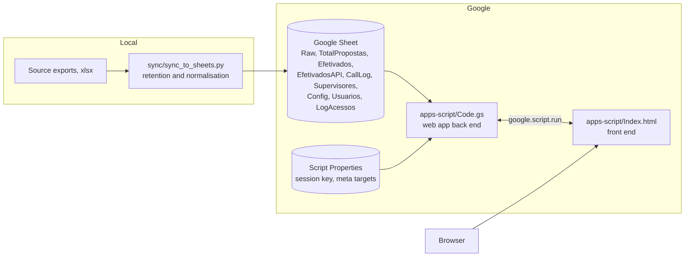
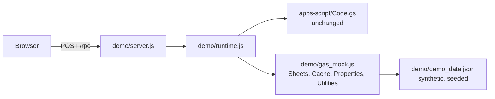

# Assina AI

A web dashboard that follows loan proposals through a digital signature and payment pipeline, with a focus on the ones that stall: proposals that were requested but never got signed, got stuck in a review stage, or were cancelled. It also has a management view with per-channel totals and a monthly efficiency target panel.

The front end and the back end both run on Google Apps Script. The data lives in a Google Sheet that is refreshed by a small Python sync script.

This is a sanitized public copy of an internal tool. Company names, partner (correspondent) names, customers, employees, sheet ids, deployment urls, credentials and every real record were removed. The demo runs on fully synthetic data.

## The problem

The operations team received spreadsheet exports of proposals and had to answer the same questions by hand, several times a day:

- Which customers have a proposal that is stalled, and at which stage?
- For each stalled or cancelled case, did anyone call the customer back after the proposal, and did the call really connect?
- How many proposals were converted (paid) today and how does that compare with the recent rhythm?
- What does each channel (call center and the API channels) look like in totals, insurance attach and amount released?

The tool replaces that manual work with a page that recomputes everything from the latest sync and lets a supervisor export exactly what is on screen.

## What it does

- **Funnel by customer.** Each customer counts once, through their most recent proposal. The funnel, the KPI cards and the stalled-cases table are all built from the same deduplicated list, so the numbers on screen agree with each other.
- **Stalled cases ("Casos Parados").** Seven stages are treated as stalled (did not re-sign, stopped at biometrics, signed but waiting, fraud check, review, automatic payment processing, pending regularisation). Every row shows the supervisor, whether the customer was called back, how many attempts, how many connected, and the first and second return tags from an optional external tabulation sheet.
- **Cancelled cases.** Reasons are grouped and normalised, cases without a named reason stay in the detail table, and the API channels get their own reason breakdown.
- **Conversion and projection.** Daily paid vs requested, joined by proposal number, with a projection from a moving average of the previous days.
- **Management view (Admin only).** Five channels, the same six metrics each, with hour by hour, day by day and month by month comparisons.
- **Efficiency target panel (Master account only).** Monthly targets, business-day calendar with Brazilian national holidays, tiers and an absenteeism reducer. In this public copy it shows clearly labelled demonstration numbers.
- **Exports.** CSV or XLSX, either from a block on screen or through a filter form. Nothing is written to a shared Drive link: the file is returned to the logged in browser as base64.
- **Own authentication.** Roles Admin, Supervisor and Operador, signed session tokens, progressive lockout.

## Technical decisions

| Decision | Why |
| --- | --- |
| Google Sheet as the database | The team already lived in spreadsheets, no server to run, and the volume (tens of thousands of rows) fits when retention is enforced. |
| Retention at the sync step | The Raw tab only keeps proposals still active plus recent paid or cancelled ones. The dashboard reads that tab on every poll, so keeping it small matters more than keeping history. History stays local. |
| Dedup by customer id, join by proposal number | Joining payments by customer marked a customer's newest, cancelled proposal as converted just because an older one had been paid. There is a test for exactly this case. |
| Cache in 90 KB chunks | The Apps Script cache refuses values above about 100 KB, and the payloads were bigger. Splitting keeps the cache effective. |
| Session token signed with a key in Script Properties | The web app is open to anyone with the link, so every data function checks a signed token with an 8 hour expiry. Roles come from the signed token, never from the client. |
| Login lockout on two axes | Login name and a per-browser device token. 5 failures lock for 2 minutes, 10 for 1 hour, 15 for 6 hours, 20 for 48 hours, cumulative until a successful login. The error message is always the same, so it does not reveal which accounts exist. |
| Export through a temporary spreadsheet | Apps Script has no native XLSX writer. The code builds a temporary sheet, exports it, and trashes it, also on failure. |
| Sync writes first and trims after | An earlier version cleared the tab and then wrote, and a network failure in between left the tab empty. |
| Call-log timestamp parsing falls back through known formats | The source changed its date format twice without notice and every call silently stopped matching. |

## Architecture



In the local demo the Google pieces are replaced by an in-memory mock:



The real `Code.gs` runs unchanged inside a Node `vm` context; only the Google services are mocked.

## Run it with fake data

Requirements: Python 3 and Node 18 or newer. There is nothing to install.

```bash
python demo/run_demo.py            # generates synthetic data for today and starts the server
# open http://127.0.0.1:8765/
```

Demo accounts (synthetic, local only). The password of each account is `demo-` followed by the login in lowercase:

| Login | Role | Notes |
| --- | --- | --- |
| `admin.demo` | Admin | sees the management view |
| `Master` | Admin | also sees the efficiency target panel |
| `supervisor.demo` | Supervisor | |
| `operator.demo` | Operador | |

To regenerate the committed fixture, which is anchored to a fixed date and used by the tests:

```bash
python demo/generate_demo_data.py --anchor 2026-10-30
```

The data is deterministic for a given seed and anchor: customers are "Customer 001", analysts are "Analyst 01", correspondents are "Correspondent A/B", phones use the invalid area code 00. It includes rows that the dashboard must ignore (unknown correspondent, a human analyst on the API desk) so the filters have something to filter.

## Tests

```bash
node --test tests/dashboard.test.js                      # 22 tests on the real Code.gs
python -m unittest discover -s tests -p "test_*.py"      # 7 tests on the sync rules (needs pandas)
python scan_sensitive.py                                 # pre-publication scan, zero findings expected
```

What the Node tests cover: money and phone normalisation, date parsing, the holiday calendar, cache chunking, login and lockout, token tampering and expiry, role checks, the stalled-cases definition (checked against an independent recount from the sheet rows), funnel and table agreement, call-back counting that only considers calls after the proposal, conversion joined by proposal number, cancelled-reason normalisation, the management channels and the CSV export.

The Python tests cover the retention window, the fixed cutoff for API rows and the call-log timestamp chain. They do not call Google.

## Deploying to Apps Script (outline)

1. Create a standalone Apps Script project and add `Code.gs`, `Index.html` and `appsscript.json`.
2. In Project Settings, add Script Properties `ASSINA_AI_SEED_ADMIN.DEMO`, `ASSINA_AI_SEED_MASTER`, `ASSINA_AI_SEED_SUPERVISOR.DEMO` and `ASSINA_AI_SEED_OPERATOR.DEMO` with initial passwords of your choice, then run `inicializarPlanilha`. It creates the database sheet and the accounts.
3. Run `configurarTriggers`, then deploy as a web app.
4. Fill the sheet with `sync/sync_to_sheets.py`, configured through the environment variables listed in its docstring. Credentials and ids are never read from the code.

Optional: set `ASSINA_AI_TABULACOES_PLANILHA_ID` to enable the external tabulation lookup.

## Limitations

- The original scraper that downloaded the source exports from an internal system is not included. It depended on that company's portal and credentials. Today the sync script expects the exports to already exist as `.xlsx` files.
- XLSX export only works on Google. The local demo returns the same rows as CSV.
- The call-log direction value defaults to `Outbound`; the original source used a different literal and the sync script reads it from `DIRECAO_SAIDA`.
- Passwords are hashed with SHA-256 and a per-user salt because Apps Script has no bcrypt or scrypt. That is better than plain text but weaker than a purpose built password hash.
- The device token used in the lockout is generated in the browser and stored in local storage. It slows down guessing from one browser, it is not a hardware identity.
- The web app is deployed as open to anyone with the link, and the protection is the token layer in `Code.gs`. A deployment restricted to a domain would be safer where available.
- Every sheet read happens inside Apps Script, so very large periods are slow. The retention rules and the cache are how this is kept in check; there is no pagination.
- The efficiency target panel shows demonstration numbers. The real data source for it was never connected.
- The test suite uses a hand-written mock of the Apps Script services. It checks the logic of this project, not Google's behaviour.
- No performance, time saving or accuracy gain is claimed here. None was measured.

## Repository layout

```
apps-script/   Code.gs, Index.html, appsscript.json
sync/          sync_to_sheets.py and requirements
demo/          synthetic data generator, Apps Script mock, local server and launcher
tests/         node:test suite and unittest suite
scan_sensitive.py   pre-publication scan (standard library only)
```

## License

No license file is included. The source is published for portfolio review and no permission to reuse it is granted.

Built with AI assistance; design, domain rules and review by the author.
